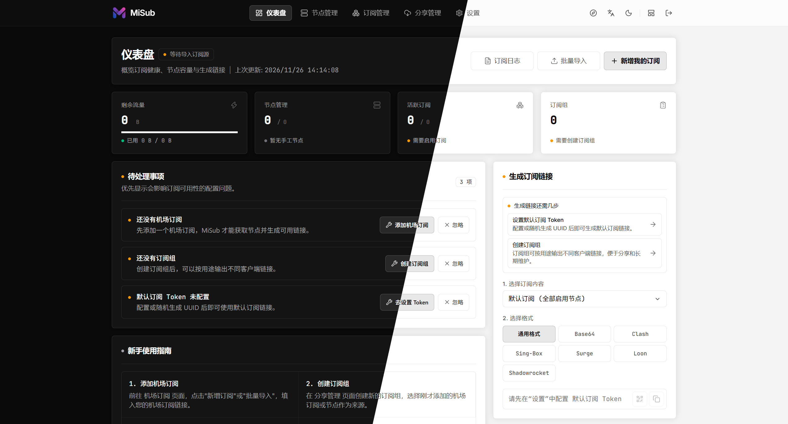
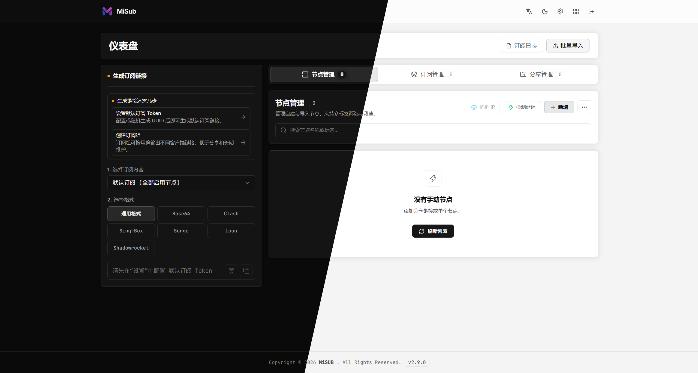

# MiSub

<div align="center">

**一个聚焦订阅节点管理、多客户端订阅生成、内置模板输出与转换链路编排的工具**

[](LICENSE)
[](https://pages.cloudflare.com/)
[](https://vuejs.org/)
[](#更新日志)

[功能特性](#功能特性) • [快速开始](#快速开始) • [部署指南](#部署指南) • [使用说明](#使用说明) • [更新日志](#更新日志)

</div>

---

## 应用截图

<div align="center">

| 登录界面 | 管理界面 |
|---------|---------|
|  |  |

</div>

---

## 功能特性

### 核心功能

- **订阅分组 (Profiles)**
  - 自由组合机场订阅和手动节点
  - 为不同场景生成专属订阅链接
  - 支持全选/全不选,操作便捷
  - 自定义分组名称和订阅链接

- **订阅与节点分离管理**
  - 机场订阅和手动节点独立管理
  - 批量导入自动分类
  - 支持拖拽排序
  - 一键按地区自动排序

- **统一模板与链式处理**
  - **操作符链 (Operator Chain)**：支持过滤、重命名、脚本、排序与去重的流式管道
  - 统一模板模型输出 Clash、Sing-Box、Surge、Loon、QX
  - 支持按客户端自动适配模板策略
  - 内置 ACL4SSR 风格完整分流模板预设
  - 支持第三方转换后端接入，MiSub 先完成节点预处理再交给外部后端转换

- **精致的 UI/UX**
  - 明亮/暗黑模式自动切换
  - 磨砂玻璃质感现代化设计
  - 完善的交互提示和加载状态
  - 响应式布局,支持移动端

- **公开主页 (Explore)**
  - 访客模式：无需登录即可预览公开分享的订阅
  - 管理员分享：精选中转/直连机场订阅
  - 一键复制：访客可直接复制订阅链接
  - 客户端推荐：主流全平台客户端下载指引

### v2.8.0 更新亮点

- **Exposed Hairline Grid 视觉重构**
  - 统一深浅色主题配色（深色底色 `#131515`、卡片 `#171717`）与高对比度悬停反馈
  - 引入 `lucide-vue-next` 图标库与统一封装的自定义 `Select` 组件
  - 优化顶部毛玻璃导航栏、主题切换对角扫光动画及桌面端双栏双向吸顶滚动

- **机场订阅与分组交互升级**
  - 拆分机场订阅专用批量导入，支持单条订阅分组与新增/编辑选组
  - 改用标签筛选分组，并由按条数分页改为按分组单元滚动无限加载
  - 优化分组模式下的两级拖拽排序（组内与组间）及统一排序模式交互

- **部署与安全加固**
  - 支持 Cloudflare Workers 静态资源托管与原生 Cron Trigger 部署
  - 防止已初始化实例回退默认管理员密码，稳定 Cookie Secret 回退逻辑

### v2.7.0 更新亮点

- **订阅生成链路增强**
  - 第三方转换后端模式不再依赖外部服务回调 MiSub 节点链接，改为内联发送预处理后的节点
  - 多节点外部转换统一使用 `|` 分隔，兼容 FatSheep / subconverter 等后端
  - 修复 Clash / Party / Shadowrocket 等客户端导入链路与目标格式识别问题
  - 服务集成 Cron 同时支持兼容链接 `/cron?secret=[REDACTED]` 与更安全的 Bearer Token Header

- **内置模板与规则输出增强**
  - 补强 ACL4SSR provider、IP-CIDR provider、远程规则集与 Sing-Box 规则源
  - 新增/优化自定义规则模板与模板变量辅助说明
  - 支持 Hysteria2 realm 等协议细节输出

- **节点刷新与缓存稳定性**
  - 订阅保存与手动刷新时保留保护性节点缓存，降低临时抓取失败对可用节点的影响
  - 节点更新失败会在 API / UI 中展示更明确的错误结果
  - 空缓存与运行时信息同步逻辑更稳健

### 主要能力

- **订阅备注**
  - 为每个订阅添加备注信息
  - 记录官网、价格、到期时间等
  - 在订阅卡片上清晰显示

- **自定义 User-Agent**
  - 为每个订阅设置独立的 UA
  - 10+ 常用客户端 UA 预设
  - 解决机场 UA 限制问题

- **Snell 协议完整支持**
  - 支持 Snell v1-v5
  - 完整的参数支持 (reuse/tfo)
  - Surge 配置导入支持

- **模板输出增强**
  - Clash / Sing-Box / iOS 客户端统一走模板主线
  - 支持远程规则集、策略组与地区分组映射
  - 支持内置模板预设与客户端能力兼容表

- **流量与到期时间显示**
  - 订阅卡片显示已用/总流量
  - 到期时间提醒，颜色高亮
  - 自动更新节点数和流量信息

### 纯 D1 八表行级存储

- **Cloudflare D1 数据库（`MISUB_DB`）**
  - 按 `subscriptions` / `nodes` / `profiles` / `guestbook` / `settings` / `cache` / `access_logs` / `error_reports` 八表职责分离存储
  - 不受 KV 每日写入次数限制，支持高频率刷新与原子计数
  - 配合单次请求内存缓存与 Edge Cache，大幅降低 D1 读写消耗

### 安全与定制

- **密码保护**: 管理界面由自定义密码保护
- **高度可定制**: 自定义输出文件名、模板来源、规则级别等
- **数据备份**: 支持导出/导入备份
- **TG 推送**: 支持 Telegram 通知

### 多格式支持

支持主流代理客户端和格式:

| 客户端 | 格式支持 | 自动识别 |
|--------|---------|---------|
| Clash / Clash Meta | 支持 | 支持 |
| Sing-Box | 支持 | 支持 |
| Surge | 支持 | 支持 |
| Shadowrocket | 支持 | 支持 |
| V2rayN / V2rayNG | 支持 | 支持 |
| Quantumult X | 支持 | 支持 |
| Loon | 支持 | 支持 |

### 支持的协议

- Shadowsocks (SS/SS2022)
- VMess
- VLESS（Quantumult X v1.5.5+ 支持 TLS / REALITY / XTLS Vision 输出）
- Trojan
- Hysteria2 / HY2
- TUIC
- Snell
- WireGuard
- AnyTLS（Quantumult X v1.6.0+ 支持）
- HTTPS
- SOCKS5 / SOCKS5-TLS

### 内置格式说明

- `clash`：兼容性最好，适合主力导出
- `surge`：支持规则模板与地区分组
- `loon`：支持规则模板与地区分组
- `quanx`：支持统一模板输出与基础策略组、规则映射
- `singbox`：JSON 输出，支持统一模板模型与路由规则映射
- `base64`：兜底格式

---

## 快速开始

### 前置要求

- Cloudflare 账号
- GitHub 账号

### 一键部署

1. **Fork 本仓库**到你的 GitHub 账号
2. 登录 [Cloudflare Dashboard](https://dash.cloudflare.com/)
3. 进入 `Workers & Pages` → `创建应用程序` → `Pages` → `连接到 Git`
4. 选择你 Fork 的仓库
5. 配置构建设置:
   - **框架预设**: `Vue`
   - **构建命令**: `npm run build`
   - **构建输出目录**: `dist`
6. 点击 `保存并部署`

---

## 部署指南

### 1. 绑定 D1 数据库 (`MISUB_DB`，必需)

MiSub 已全面采用纯 **Cloudflare D1** 存储架构（不再使用 KV）。未绑定 `MISUB_DB` 时系统会进入只读空适配器状态，无法持久化保存数据。

**创建并初始化 D1 数据库:**
```bash
npx wrangler d1 create misub
npx wrangler d1 execute misub --file=schema.sql --remote
```

> ⚠️ **Fork 用户提示**：若通过 `wrangler.jsonc` 部署 Workers，请务必将 `d1_databases` 中的 `database_id` 替换为你自己创建的 D1 数据库 ID。

**绑定数据库（Pages 或 Workers Dashboard）:**
1. `设置` → `绑定`（或 Pages 的 `设置` → `函数` → `D1 数据库绑定`）
2. 点击 `添加绑定`
3. **变量名称**: `MISUB_DB`
4. **D1 数据库**: 选择刚创建的数据库

> 若 CLI 初始化失败，可在 Cloudflare 控制台 D1 控制台中手动执行 `schema.sql` 全部内容。

### 2. 设置环境变量

在 `设置` → `环境变量` 中添加 **生产环境** 变量：

> **安全提示（必读）**：
> - `ADMIN_PASSWORD`、`COOKIE_SECRET`、`CRON_SECRET` 等敏感变量在 Cloudflare 控制台添加时，**类型务必选择 `Secret`（加密密钥）**，切勿选成普通文本（Text）。
> - 使用 `wrangler deploy` / Git 自动部署时，若 `wrangler.jsonc` 中配置了 `vars` 且未开启 `"keep_vars": true`，控制台手动添加的**普通文本变量会被覆盖清空**，而 `Secret` 密钥不受影响。
> - 也可直接通过命令行注入加密密钥：`npx wrangler secret put ADMIN_PASSWORD`

**必选：**

| 变量名 | 说明 | 示例 |
|--------|------|------|
| `ADMIN_PASSWORD` | 管理员登录密码（Secret，未配置时拒绝登录；修改后旧会话自动失效） | `your_secure_password` |

**推荐：**

| 变量名 | 说明 | 示例 |
|--------|------|------|
| `COOKIE_SECRET` | Cookie 签名密钥（Secret，可选；留空时由 `ADMIN_PASSWORD` 稳定派生，修改后旧会话自动失效） | `64位随机字符串` |

**可选（按需设置）：**

| 变量名 | 说明 | 示例 |
|--------|------|------|
| `CRON_SECRET` | 外部 `/cron/*` 定时任务校验密钥（Secret，可选；也可在管理后台「服务集成」中设置） | `your_cron_secret` |
| `CORS_ORIGINS` | 允许跨域访问的来源(逗号分隔)，同域可不填 | `https://sub.libk.top,http://localhost:5173` |
| `MISUB_PUBLIC_URL` | 站点对外访问的公开域名，用于生成订阅转换回调地址 | `https://sub.libk.top` |
| `MISUB_CALLBACK_URL` | 订阅转换回调基础地址（优先级高于 MISUB_PUBLIC_URL），通常保持默认即可 | `https://sub.libk.top` |
| `GITHUB_TOKEN` | GitHub 个人访问令牌（只读公开仓库即可），用于提升版本检查与公开页客户端版本号拉取的 GitHub API 限额（建议设为 `Secret`） | `ghp_xxxx` / `github_pat_xxxx` |

**前端构建变量（可选）：**

| 变量名 | 说明 | 示例 |
|--------|------|------|
| `VITE_ERROR_REPORT_URL` | 前端错误上报地址，不需要上报可不填 | `/api/system/error_report` |

> 提示：启用错误上报后会发送页面地址与浏览器信息等运行数据，请根据隐私与合规要求进行评估与披露。

### 3. 重新部署

完成配置后,在 `部署` 选项卡重新部署项目。

---
## 使用说明

### 登录管理界面

1. 部署完成后，公开页面默认 **不开启**（访问域名会显示伪装页）。
2. 请直接访问 `您的域名/login` 进入登录页面。
3. 输入已配置的 `ADMIN_PASSWORD` 即可进入管理后台。
    - **安全说明**：未配置 `ADMIN_PASSWORD` 时系统会拒绝登录（fail-closed）；在 Cloudflare 控制台（Secret）或 `.dev.vars` 中修改 `ADMIN_PASSWORD` 后，所有旧登录会话会立即失效。

### 添加订阅

1. 点击 `新增订阅`
2. 填写订阅名称和链接
3. (可选) 设置自定义 UA
4. (可选) 添加备注信息
5. (可选) 设置操作符链
6. 保存订阅

### 创建订阅组

1. 在右侧面板点击 `新增订阅组`
2. 选择要包含的订阅和节点
3. 设置分组名称
4. 保存并获取订阅链接

### 转换链路说明

MiSub 默认使用内置转换器将订阅内容转换为目标格式，并支持按需接入第三方转换后端。

处理顺序统一为：机场订阅 / 手动节点 → MiSub 节点预处理（拉取、解析、过滤、重命名、去重、排序等）→ 内置模板输出或第三方后端转换。

当启用第三方转换后端时，MiSub 会把预处理后的节点以内联方式交给外部后端，避免外部后端再次回调 MiSub 节点链接造成 `No nodes were found!` 等抓取失败。多节点会使用 `|` 分隔，以兼容常见 subconverter / FatSheep 后端。

支持的目标格式：

- `clash`
- `surge`
- `loon`
- `quanx`
- `singbox`
- `base64`

内置转换说明：

- `surge` 会根据客户端或 URL 参数保留版本感知。
- `singbox` 会输出 JSON 配置。
- 不支持的目标格式会回退为 `base64`。
- 若在设置或订阅组中启用第三方转换，MiSub 会先完成节点预处理，再将节点交给第三方后端输出目标格式。

### 远端模板占位符

如果你在 `transformConfig` 中使用远端模板，可以在模板里放入以下占位符：

- `<%proxies%>`: 已渲染的代理块
- `<%rules%>`: 规则块
- `<%fileName%>`: 输出文件名
- `<%interval%>`: 刷新间隔
- `<%managedConfigUrl%>`: 模板地址
- `<%targetFormat%>`: 目标格式
- `<%nodeCount%>`: 节点数量
- `<%regionGroups%>`: 地区分组 JSON
- `<%regionGroupNames%>`: 地区分组名称列表
- `<%regionGroupCounts%>`: 地区分组及数量
- `<%regionGroupList%>`: 地区分组清单

#### 示例

```yaml
proxies:
<%proxies%>

proxy-groups:
  - name: 节点选择
    type: select
    proxies:
      - 自动选择
      - <%regionGroupNames%>

  - name: 自动选择
    type: url-test
    url: http://www.gstatic.com/generate_204
    interval: <%interval%>
    proxies:
      - <%regionGroupNames%>

rules:
<%rules%>
```

### 定时任务（Worker 原生 Cron & 外部 `/cron/*`）

- **Cloudflare Workers 原生 Cron Triggers**：使用 `wrangler.jsonc` 部署时默认启用三项独立定时任务（每 6 小时同步订阅、每日 02:00 UTC WebDAV 备份、每日 03:30 UTC 维护清理），无需额外配置外部服务。
- **外部 `/cron/*` 接口**：适合 Cloudflare Pages 等不支持原生 Cron Trigger 的场景，按业务拆分为 `/cron/subscriptions`、`/cron/backup`、`/cron/maintenance`、`/cron/rotate-token`。
  - **推荐方式**：在请求头设置 `Authorization: Bearer <SECRET>`，避免密钥出现在 URL 和访问日志中。
  - **兼容方式**：支持 `?secret=<SECRET>` 查询参数；密钥可在后台「服务集成」设置，或通过 `CRON_SECRET` Secret 环境变量注入。

### 代理抓取 (Vercel)

如果由于网络限制导致订阅内容抓取失败，可以额外部署一个用于抓取转发的 Edge Functions 代理并在订阅设置中填写代理地址。

> 说明：该代理仅作为可选的辅助抓取组件，不属于 MiSub 主站部署方式。MiSub 主站支持部署在 Cloudflare Workers 或 Cloudflare Pages。

## 项目架构与目录结构

MiSub 采用 `pnpm` Monorepo 工作区结构，前后端职责边界清晰：

- **`packages/core`（`@misub/core` 共享核心包）**：零 DOM/Node/Worker API 依赖，统一承载协议解析与互转、统一节点中间表示（`NodeIR`）、Zod v4 数据契约及 JSDoc `@typedef`、操作符链与表达式 DSL 引擎。
- **`functions/` 与 `worker.js`（边缘计算后端）**：基于 **Hono** 构建统一路由与洋葱中间件（会话续期、CORS/CSRF、Cookie/Bearer 鉴权、Zod 入参校验与 `onError`）；订阅转换管线按 `User-Agent` **按需动态懒加载 (`await import(...)`)** 各客户端 `ClientAdapter` 生成器与模板渲染器；通过 `Repository` 仓储层封装 **内存 -> Cloudflare Cache API -> D1** 三级缓存及 `db.batch([...])` 批量写入合并。
- **`src/`（Vue 3 管理前端）**：使用 **`@tanstack/vue-query`** 接管后端异步数据请求与失效刷新，Pinia Store 统一规范为 `useXxxStore.js`（如 `useDataStore.js`、`useSessionStore.js`、`useSettingsStore.js`），导入入口统一收敛至 [ImportModal.vue](src/components/modals/ImportModal.vue)。

完整架构与请求链路说明请见 [docs/architecture/overview.md](docs/architecture/overview.md)。

## 本地开发

```bash
pnpm install
npx wrangler d1 execute misub --file=schema.sql --local
pnpm dev
```

本地调试 Worker + D1（在 `.dev.vars` 中配置 `ADMIN_PASSWORD`）：

```bash
pnpm dev:worker
```

使用 Cloudflare Pages Functions 本地验证完整构建产物：

```bash
pnpm build
npx wrangler pages dev dist --d1 MISUB_DB=misub
```

常用校验命令：

```bash
pnpm exec oxlint
pnpm test
pnpm run test:e2e
pnpm build
```

---

## 技术栈

- **前端**: Vue 3 + Vite 8 + Tailwind CSS 4 + TanStack Vue Query + Pinia
- **共享核心**: `@misub/core` (`pnpm` Monorepo Workspace + Zod + NodeIR + Operator DSL)
- **后端**: Cloudflare Workers / Pages Functions + Hono
- **存储**: Cloudflare D1 数据库（`MISUB_DB` 八表行级存储 + Repository 多级缓存）
- **质量与测试**: Oxlint + Vitest + Playwright
- **部署平台**: Cloudflare Workers（推荐）/ Cloudflare Pages

---

## 更新日志

### v2.8.0 (2026-11-15)

**重点更新：全新极简网格 UI 重构、分组交互升级与 Workers 部署支持**
- **Exposed Hairline Grid 视觉重构** - 统一深浅色主题配色、按钮与输入框质感，引入 `lucide-vue-next` 图标库及自定义 `Select` 组件。
- **机场订阅与分组体验升级** - 拆分机场订阅专用批量导入并支持单条选组，改用标签筛选分组与按分组单元无限加载，支持组内与组间两级拖拽排序。
- **订阅组与弹窗优化** - 支持订阅组拖拽排序、加宽订阅组弹窗、对齐资源列表并补充订阅分组筛选。
- **Workers 部署与安全加固** - 支持 Cloudflare Workers Static Assets 与原生 Cron 部署，防止已初始化实例回退默认管理员密码。

### v2.7.0 (2026-05-20)

**重点更新：订阅生成链路、内置模板与服务集成稳定性增强**
- **第三方转换链路重构** - 第三方转换模式统一先由 MiSub 完成节点预处理，再以内联节点交给外部后端，避免外部后端回调 MiSub 链接导致 `No nodes were found!`。
- **外部转换兼容增强** - 多节点内联统一使用 `|` 分隔，提升 FatSheep / subconverter 等后端对多节点输入的解析稳定性。
- **客户端导入链路修复** - 修复 Clash Party、Shadowrocket 等客户端导入链接与目标格式识别问题，确保订阅输出语义一致。
- **内置模板与规则集补强** - 优化 ACL4SSR provider、IP-CIDR provider、Sing-Box 内置规则源、远程规则集与地区分组映射。
- **自定义规则模板体验** - 新增自定义规则模板能力，优化模板变量帮助文本与折叠交互，减少配置误用。
- **节点刷新与缓存保护** - 订阅保存、手动刷新与外部抓取失败场景下更稳健地保留可用缓存，并在 UI/API 中呈现更明确的失败信息。
- **服务集成 Cron 兼容恢复** - 后端同时支持 `/cron?secret=[REDACTED]` 兼容链接与 Bearer Token Header 推荐方式，修复服务集成页面复制链接后返回 `Unauthorized` 的问题。
- **安全与协议细节** - 加固安全边界，移除直接 `eval` fallback，并补强 Hysteria2 realm、Egern emoji、Quantumult X v1.6.0 AnyTLS、v1.5.5 VLESS TLS / REALITY / XTLS Vision 等协议输出细节。

### v2.5.0 (2026-04-10)

**重大更新：节点处理引擎大统一与性能优化**
- **操作符链 (Operator Chain)** - 实现节点处理的流式管道化，彻底替代旧版“净化管道”。
- **架构剥离** - 移除了 VPS 监控探针等冗余功能，回归订阅管理核心定位。
- **去中心化转换** - 完善内置转换引擎，减少对外部后端接口的依赖。
- **兼容性桥接 (Legacy Bridge)** - 无缝兼容旧版规则并提供一键迁移工具。
- **Wiki 同步** - 全新编写了操作符指南与升级手册。

### v2.4.0 (2026-01-14)

**重点更新：统一模板与订阅生成增强**
- **统一模板主线扩展** - 多客户端逐步接入统一模板模型与内置模板预设
- **多端渲染能力增强** - iOS 客户端与 Sing-Box 的模板输出持续补强
- **项目定位收敛** - 聚焦订阅节点管理与多客户端订阅生成


### v2.3.0 (2026-01-03)

**重要更新:**
- **订阅与节点管理重构** - 订阅编辑、配置文件、节点管理与设置模块全面重构，新增节点筛选、规则编辑与统计卡片
- **订阅管理能力增强** - 新增订阅管理模块，支持多协议转换，强化手动节点管理
- **统一 ID 与数据流** - 引入统一 ID 生成工具，订阅/配置/节点数据整合到 `useDataStore`，移除旧备份与过时认证模块

**接口与安全:**
- **统一 API 响应** - 统一错误处理与响应格式，新增订阅解析模块
- **安全与请求** - 引入 DOMPurify 清理 SVG，API 调用迁移到 `lib/http.js`，优化 CORS 并新增错误上报

**工具与开发体验:**
- **日志与工具函数** - 优化日志级别与调试输出，统一 timing 常量，`formatBytes` 迁移到共享工具，更新地理工具函数
- **路由与构建** - 新增 Vite 代理规则，移除 `PublicProfilesView` 路由，首页增加 `/explore` 别名
- **测试覆盖** - 新增节点缓存服务单元测试

### v2.2.0 (2026-01-02)

**核心功能更新:**
- **可视化节点筛选** - 全新的节点规则编辑器，支持标签化管理包含/排除关键词，内置常用地区与协议标签，配置更轻松
- **自定义公开页 Hero** - 支持在后台自定义公共主页的标题与标语，打造个性化门户
- **留言板增强** - 新增数学验证码 (Captcha) 防护机制，优化提交成功反馈体验
- **交互体验优化** - 留言板禁用时提供友好的 Toast 提示，优化移动端入口逻辑

**界面重构:**
- **设置页全新设计** - 基础设置与服务集成页面采用现代化卡片式布局，功能分区更清晰
- **视觉优化** - 统一了图标风格与色彩系统，优化深色模式体验
- **二维码组件** - 修复二维码遮罩层级与交互问题

**其他改进:**
- **客户端识别升级** - 增强对 Surge、Stash 等客户端的 User-Agent 识别准确度
- **API 修正** - 修复公开配置接口字段缺失问题，增强后端数据安全性

### v2.1.0 (2025-12-30)

**新增功能:**
- **公开主页 (Explore)** - 访客可无需登录浏览精选订阅
- **访客模式** - 支持公共资源分享与客户端下载指引
- **新版登录流程** - 统一入口，更加安全便捷
- **布局优化** - 适配公开页与仪表盘的无缝切换

**改进优化:**
- 优化订阅卡片显示
- 修复 SS2022 节点错误
- 完善文档和使用说明

### v2.0.0 (2025-12-22)

**新增功能:**
- 订阅备注功能 - 记录官网、价格等信息
- 自定义 User-Agent - 解决机场 UA 限制
- Snell 协议完整支持 - 包含 reuse/tfo 参数
- Snell 协议完整支持 - 包含 reuse/tfo 参数
- Surge 配置解析增强 - 支持更多参数

### v1.5.0

**新增功能:**
- D1 数据库支持 - 解决 KV 写入限制
- 一键数据迁移工具
- 存储类型选择

### v1.0.0

**核心功能:**
- 订阅分组 (Profiles)
- 订阅与节点分离管理
- 全新 UI 设计
- 密码保护

---

## 致谢

本项目基于 [imzyb/MiSub](https://github.com/imzyb/MiSub) 与 [CF-Workers-SUB](https://github.com/cmliu/CF-Workers-SUB) 发展而来，感谢原作者的开源贡献。

---

## License

[MIT](LICENSE)

---

## 贡献

欢迎提交 Issue 和 Pull Request!
