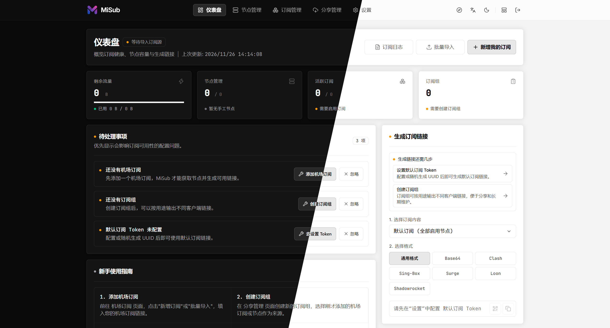
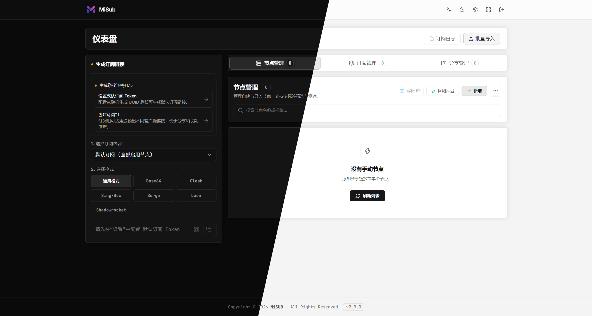

# MiSub

> 中文说明请见 [README-zh.md](README-zh.md)。

<div align="center">

**A lightweight subscription management panel for organizing proxy nodes, generating client-ready subscriptions, and composing node-processing workflows.**

[](LICENSE)
[](https://pages.cloudflare.com/)
[](https://vuejs.org/)
[](#version)

[Features](#features) • [Quick Start](#quick-start) • [Deployment](#deployment) • [Usage](#usage) • [Documentation](#documentation)

</div>

---

## Overview

MiSub helps you manage upstream subscriptions and manual nodes, combine them into profiles, process nodes through a visual operator chain, and publish subscription links for common proxy clients.

It is designed for personal and small-team usage: simple operations, clear client links, safe defaults, and flexible Cloudflare Pages deployment.

## Screenshots

<div align="center">

| Login | Dashboard |
|------|-----------|
|  |  |

</div>

## Features

- **Profiles**: combine upstream subscriptions and manual nodes into scenario-specific subscription profiles.
- **Subscription and node management**: manage airport subscriptions, manual nodes, groups, ordering, remarks, traffic, and expiry data.
- **Operator Chain**: process nodes with filter, regex rename, script/DSL execution, sorting, and smart deduplication steps.
- **Multi-client output**: generate subscription output for Clash/Mihomo, Sing-Box, Surge, Loon, Quantumult X, Shadowrocket, V2rayN/V2rayNG, and base64 clients.
- **Built-in templates**: use unified template output, rule-set presets, region groups, policy groups, and custom rule templates.
- **Custom public page**: publish a public explore page or an immersive disguise/custom page with sanitized HTML rendering.
- **Structured D1 storage**: powered by Cloudflare D1 (`MISUB_DB`) with an 8-table row-level schema (`subscriptions`, `nodes`, `profiles`, `guestbook`, `settings`, `cache`, `access_logs`, `error_reports`) for high write volume and atomic counters.
- **Notifications and operations**: support Telegram notifications, scheduled refresh, backup/restore, logs, and diagnostics.
- **Modern UI**: responsive Vue 3 interface with light/dark modes and English/Chinese localization.

## Supported Protocols

- Shadowsocks / SS2022
- VMess
- VLESS
- Trojan
- Hysteria2 / HY2
- TUIC
- Snell
- WireGuard
- AnyTLS
- HTTPS
- SOCKS5 / SOCKS5-TLS

## Supported Output Formats

- `clash` / Mihomo YAML
- `surge`
- `loon`
- `quanx`
- `singbox`
- `base64`
- external converter backend mode

## Quick Start

### Prerequisites

- A GitHub account
- A Cloudflare account
- Node.js 20+ for local development

### Deploy to Cloudflare Workers (Recommended) / Pages

MiSub natively supports **Cloudflare Workers** (Static Assets + built-in Cron Triggers via [wrangler.jsonc](wrangler.jsonc)) as well as **Cloudflare Pages**.

1. Fork this repository.
2. Create your own D1 database and replace `database_id` in `wrangler.jsonc` (or bind `MISUB_DB` in the Cloudflare Dashboard).
3. For Workers: connect your forked repo in `Workers & Pages` → `Create` → `Workers` (or run `pnpm deploy:worker`).
4. For Pages: create a Pages project with build command `npm run build` and output directory `dist`.
5. Bind `MISUB_DB` and initialize the D1 schema before production use.

## Deployment

### Required D1 binding

Cloudflare D1 (`MISUB_DB`) is the **required** primary storage binding for MiSub.

```bash
npx wrangler d1 create misub
npx wrangler d1 execute misub --file=schema.sql --remote
```

Update `database_id` in `wrangler.jsonc` (for Workers) or bind the database in Pages settings (`Functions` → `D1 database bindings`):

- Variable name: `MISUB_DB`
- Binding type: D1 database

> Note: When `MISUB_DB` is not bound, MiSub safely falls back to a read-only no-op adapter and changes will not persist. If CLI schema execution fails, run the contents of `schema.sql` manually in the Cloudflare D1 console.

### Recommended environment variables

> **Security Note**: Always configure `ADMIN_PASSWORD`, `COOKIE_SECRET`, and `CRON_SECRET` as **Secret** (encrypted) in the Cloudflare Dashboard (or via `npx wrangler secret put <KEY>`), **not** as plaintext variables. Plaintext dashboard variables are overwritten by `vars` in `wrangler.jsonc` on deploy unless `"keep_vars": true` is set.

- `ADMIN_PASSWORD` (**required**): admin login password (configure as a Secret). Login fails closed if unset, and rotating `ADMIN_PASSWORD` immediately invalidates existing sessions.
- `COOKIE_SECRET`: optional session signing secret (configure as a Secret; never persisted to D1, derived deterministically from `ADMIN_PASSWORD` if omitted, and rotating it immediately invalidates existing sessions).
- `CORS_ORIGINS`: allowed browser origins for API requests.
- `CRON_SECRET`: secret used by external `/cron/*` triggers (configured as a Secret, or set in admin settings; D1 setting takes precedence if both are set).
- `MISUB_PUBLIC_URL`: public site URL used to generate subscription conversion callback URLs.
- `MISUB_CALLBACK_URL`: callback base URL for subscription conversion. It takes precedence over `MISUB_PUBLIC_URL`.
- `GITHUB_TOKEN`: optional read-only GitHub token (configure as a Secret) to avoid GitHub REST API rate limits when checking releases and client versions.

Never commit real tokens, cookies, UUID/private keys, webhook secrets, bot tokens, subscription URLs, or airport domains.

## Architecture & Workspace Layout

MiSub is organized as a `pnpm` monorepo with strict separation between shared domain logic, edge runtime, and UI:

- **`packages/core` (`@misub/core`)**: Environment-agnostic protocol parsers, `NodeIR` intermediate representation, Zod schemas, JSDoc `@typedef` contracts, and operator/expression DSL shared by both frontend and backend.
- **`functions/` & `worker.js`**: Cloudflare Workers / Pages Functions backend built with **Hono**, onion CORS/CSRF/auth middlewares, Zod request validation, lazy-loaded `ClientAdapter` subscription generators/renderers (`await import(...)`), and a **Repository + 3-tier cache (`Memory -> Cache API -> D1`)** layer with `db.batch(...)` coalesced writes.
- **`src/`**: Vue 3 + Vite 8 + Tailwind CSS 4 frontend using **`@tanstack/vue-query`** for server state, canonical `useXxxStore.js` Pinia stores, and the unified [ImportModal.vue](src/components/modals/ImportModal.vue).

See [docs/architecture/overview.md](docs/architecture/overview.md) for the full module map and request pipeline.

## Local Development

```bash
pnpm install
npx wrangler d1 execute misub --file=schema.sql --local
pnpm dev
```

For local Cloudflare Worker + D1 testing (configure `ADMIN_PASSWORD` in `.dev.vars`):

```bash
pnpm dev:worker
```

To test the production static build through Cloudflare Pages Functions locally:

```bash
pnpm build
npx wrangler pages dev dist --d1 MISUB_DB=misub
```

Useful commands:

```bash
pnpm exec oxlint
pnpm test
pnpm run test:e2e
pnpm build
pnpm preview
```

## Usage

1. Log in to the admin panel.
2. Add upstream subscriptions or manual nodes.
3. Create profiles that combine selected sources and manual-node groups.
4. Configure the operator chain if you need filtering, renaming, sorting, or deduplication.
5. Copy the generated client link or QR code.
6. Import the link into your preferred proxy client.

## Operator Chain

Profiles can inherit a global default operator chain or define their own processing flow. Available operators include:

- Filter nodes by protocol, region, include regex, or exclude regex.
- Rename nodes with regex replacement or templates.
- Apply restricted script/DSL operations.
- Sort nodes by weighted conditions and custom region priority.
- Deduplicate nodes with protocol-aware smart rules.

## Security Notes

- Admin APIs are password/session protected.
- Custom public HTML is sanitized before rendering.
- User-provided scripts are not executed in the main page context.
- External resource loading and iframe URLs are restricted by renderer policy.
- Subscription fetch and preview flows include SSRF-oriented safeguards.
- Use strong secrets for `ADMIN_PASSWORD`, `COOKIE_SECRET`, and `CRON_SECRET`.

## Documentation

- [Architecture Guide](docs/architecture/overview.md)
- [Chinese README](README-zh.md)

## Version

Current version: `v2.8.6`

For detailed historical changes, see [README-zh.md](README-zh.md) and the repository commit history.

## Acknowledgements

This project is based on [imzyb/MiSub](https://github.com/imzyb/MiSub) and [CF-Workers-SUB](https://github.com/cmliu/CF-Workers-SUB). Thanks to the original authors for their open-source contributions.

## License

MIT License. See [LICENSE](LICENSE).
